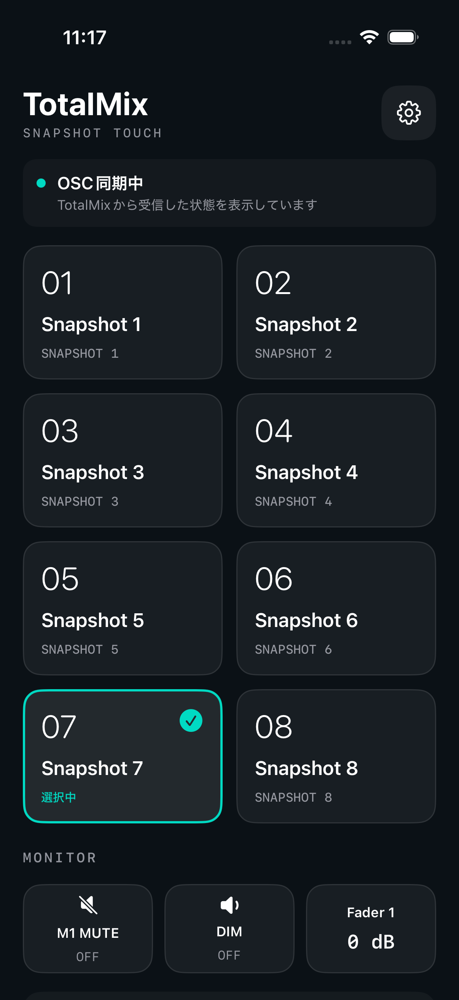
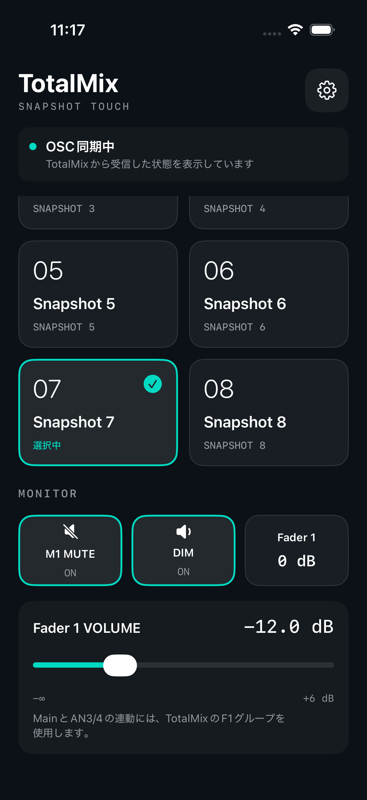

# iPhone / iPad版 TotalMix Touch

App Storeを経由せず、自分のiPhoneへXcodeからインストールして使うネイティブアプリです。iOS / iPadOS 17以降に対応します。Macの画面転送やOpenDisplayは不要です。

Snapshot 1〜8、表示名・HIDE、M1 MUTE、DIM、Fader 1の音量・0 dB操作ができます。選択中Snapshot・ミュート・DIM・音量の表示はTotalMixから受け取った状態です。アプリの起動・復帰だけでミックスや音量を復元することはありません。

 

画面例はiPhone 17 Proシミュレーターで、テスト用OSC応答を受信した実アプリのスクリーンショットです。実機TotalMixの接続結果ではありません。[接続設定画面](screenshots/iphone-settings.png)も参照できます。

## 1. iPhoneにインストールする

必要なものはMac、Xcode、Apple Account、iOS 17以降のiPhoneです。自分の端末で使う開発用インストールには無料のPersonal Teamを利用できます。

1. `TotalMixSnapshotTouch.xcodeproj`をXcodeで開きます。
2. XcodeのSettings → Apple Accountsで自分のApple Accountを追加します。
3. プロジェクト内の**TotalMixSnapshotTouchIOS**ターゲット → Signing & Capabilitiesを開き、**Automatically manage signing**をON、**Team**に自分のPersonal Teamまたは開発チームを選びます。Bundle Identifierの重複が表示された場合は、自分用の識別子に変更します。
4. iPhoneをUSBでMacへ接続し、iPhoneでコンピュータを信頼します。Xcodeの実行先に自分のiPhoneを選びます。
5. iPhoneの設定 → プライバシーとセキュリティ → **デベロッパモード**を有効にし、案内に従って再起動・確認します。項目が見つからない場合は、先にXcodeとのペアリングを開始してください。
6. Xcodeのschemeを**TotalMixSnapshotTouchIOS**にしてRun（`⌘R`）します。端末側で開発元の信頼確認が求められた場合は、設定の案内に従います。
7. 接続設定後、ローカルネットワークへのアクセスを求められたら**許可**します。

無料のPersonal Teamではプロビジョニングプロファイルの有効期間は発行から**7日**です。期限後はXcodeから再ビルド・再インストールしてください。この制約はアプリの有効期限を変更しても回避できません。[AppleのPersonal Teamの説明](https://developer.apple.com/help/account/basics/about-your-developer-account)

実機で起動するにはコード署名とプロビジョニングが必要です。下記の`make ios-device`で得られる未署名の`.app`はコンパイル確認用で、そのままiPhoneへインストールできません。[Appleの実機実行手順](https://help.apple.com/xcode/mac/current/en.lproj/dev5a825a1ca.html)、[デベロッパモードの説明](https://developer.apple.com/documentation/xcode/enabling-developer-mode-on-a-device)

`make project`はXcodeプロジェクトを再生成します。Xcodeで選んだTeamや変更したBundle Identifierも生成時の値に戻るので、再生成後は署名設定を選び直してください。Team IDや証明書・Apple Account情報はソースに保存していません。

## 2. 同じLANで接続する

iPhoneをMacと通信できるWi-Fiへ接続します。Macは同じLANへの有線接続でも構いません。ゲストWi-Fiなど端末間通信が禁止されているネットワークでは使えません。

次の2つのIPv4アドレスを確認します。

- **Macのアドレス**：Macのシステム設定 → ネットワーク → 使用中の接続 → 詳細 → TCP/IPにあるIPアドレス。
- **iPhoneのアドレス**：iPhoneの設定 → Wi-Fi → 接続中のネットワークのⓘ → IPアドレス。

この版はIPv4アドレスを直接入力します。ホスト名・Bonjour自動検出・IPv6には対応していません。`127.0.0.1`はiPhone自身を指すため、実機ではMacのLANアドレスを入力してください。

### TotalMix側：iPhone専用Controllerを用意する

Mac版アプリがController 1（7001 / 9001）を使用している場合に備え、iPhone版には**Controller 2**と別のポートを使用します。

TotalMixのOptions → **Enable OSC Control**をONにし、Mixer Settings → OSCを設定します。

| TotalMixの項目 | iPhone用の設定例 |
| --- | --- |
| Controller | **2**、In Use: **ON** |
| Port incoming | **7002** |
| Remote Controller Address / Host | **iPhoneのWi-Fi IPv4アドレス** |
| Port outgoing | **9002** |
| Compatibility | **TotalMix 1.90 / 1.96の従来OSCモード** |
| Send Level Data | **OFF**で可 |

Global OSCモードには対応していません。他のリモコンがController 2を使っている場合は、空いているControllerとポートを選んでください。

### TotalMix側：Main出力とグループを設定する

1. **Control Room → Assign → Main Out → Analog 1/2**を選び、Control RoomにMainのフェーダーが表示されることを確認します。他の出力をMainにする場合は、その出力を選んでください。
2. ミュート対象のチャンネルを**Mute Group 1（M1）**へ登録します。
3. **Main（AN1/2）とAN3/4**を**Fader Group 1（F1）**へ登録し、グループを有効にします。

Main Outが**None**のままでは、アプリのフェーダーの操作対象となるMainがありません。SnapshotがOSC同期中でも、音量と0 dBは操作できません。アプリはMainを操作し、AN3/4への連動はTotalMixのF1グループが行います。

### iPhone側：「設定」から接続する

| iPhoneアプリの項目 | 設定例 |
| --- | --- |
| MacのIPv4アドレス | **TotalMixが動いているMacのLAN IPv4アドレス** |
| 送信ポート | **7002**（TotalMixのPort incomingと一致） |
| 受信ポート | **9002**（TotalMixのPort outgoingと一致） |
| OSC | **有効** |

適用・再接続すると、TotalMixからの応答後に操作できるようになります。TotalMixのHostへMacのアドレスを入れたり、アプリの送信先へiPhoneのアドレスを入れたりしないようにしてください。

MacやiPhoneのIPアドレスがDHCPで変わった場合は、両側の設定を更新します。継続使用にはルーターのDHCP予約が便利です。アプリの利用中にインターネット接続や追加のMac常駐ソフトは必要ありません。

## 3. 操作する

- **Snapshot**：大きなボタンで呼び出します。現在の選択はTotalMixの応答で強調されます。
- **名前・HIDE**：設定画面で編集します。すべて非表示にしても設定から戻せます。Mac版とは別にiPhone内へ保存します。
- **M1 MUTE / DIM**：TotalMix側のMute Group 1 / Control Room Dimを切り替えます。
- **Fader 1 VOLUME / 0 dB**：Mainを操作します。Main（AN1/2）とAN3/4をTotalMixの有効なF1グループに入れると、音量差を保って連動します。0 dBはMainを0 dBにする操作です。

画面を閉じたり別のアプリへ切り替えたりすると通信を停止して未確認状態へ戻します。復帰時に現在値を再取得します。約4秒間応答がなくなった場合も操作を無効化します。アプリをバックグラウンドで常時接続する用途には対応していません。

## 接続できないとき

| 症状 | 確認すること |
| --- | --- |
| 応答待ちのまま | Mac / iPhoneのIP、TotalMixのHost・OSC有効・In Use・互換モード、両側のポート |
| OSC同期中でもフェーダー・0 dBが動かない | TotalMixのControl Room → Assign → Main OutでAnalog 1/2など実際のMain出力を選ぶ。Noneのままでは操作対象がない |
| Mainだけ音量が変わる | MainとAN3/4がTotalMixのF1メンバーになっているか、F1が有効かを確認 |
| ローカルネットワークを拒否した | iPhoneの設定 → プライバシーとセキュリティ → ローカルネットワークでTotalMix Touchを許可 |
| 同じWi-Fiでも届かない | ゲストWi-Fiの端末分離、MacのファイアウォールでTotalMixのUDP受信が許可されているか |
| Mac版から操作できなくなった | Controller 1のHostをiPhoneへ変更していないか。iPhoneには専用Controllerを使う |
| 受信ポートを開けない | 同じ端末で同じポートを利用する別のアプリが動いていないか |
| iPhoneのIPが変わった | TotalMixのRemote Controller Address / Hostを現在のiPhoneのIPへ更新 |
| 期限後に起動できない | Personal Teamの署名期限を確認し、Xcodeから再インストール |

## ビルド・検証

```sh
make ios-build   # シミュレーター用Debugビルド
make ios-device  # 実機arm64用Releaseの未署名ビルド
make ios-test    # iPhone 17 ProシミュレーターのUIテスト
make test        # 共通モデル・OSC通信のローカルUDPテスト
```

別のシミュレーターを使う場合：

```sh
make ios-test IOS_TEST_DESTINATION='platform=iOS Simulator,name=iPhone 17'
```

生成先：

- シミュレーター：`build/ios/Build/Products/Debug-iphonesimulator/TotalMixSnapshotTouchIOS.app`
- 実機向け未署名：`build/ios-device/Build/Products/Release-iphoneos/TotalMixSnapshotTouchIOS.app`

自動テストはテスト用UDPポートと模擬OSC応答を使います。実機TotalMixの音量・Snapshotへコマンドを送りません。iPhone実機のローカルネットワーク許可、Wi-Fi経由の実際のTotalMix操作、F1のオーディオインターフェース連動は、署名して端末へインストールした後の確認対象です。

2026-10-27の確認結果：

- iPhone 17 Pro / iOS 26.5シミュレーターでUIテスト2件が成功。画面からSnapshot・M1・DIM・0 dB・音量を操作し、実UDPパケットと応答表示を確認。応答停止時の無効化、全SnapshotのHIDEと再表示も確認。
- 共通モデル・OSCテスト5件が成功。接続前の操作抑止、送信元IPの制限、設定保存、切断・再接続を検証。
- iOS実機arm64向けの未署名Releaseビルド、および既存Mac版のReleaseビルドが成功。
- iPhone 17 / iOS 27.0へ開発用署名付きアプリをインストールし、ホーム画面から起動できることをユーザー確認済み。
- 実機のフェーダー不動はTotalMixのMain OutがNoneだったことが原因。Analog 1/2へ割り当て直した後、Mac版とiPhone版の両方でMainフェーダーが連動することをユーザー確認済み。iPhoneからの`/1/mastervolume`送信と、TotalMixからの音量・dB応答も実UDPで確認。他のF1メンバーへの連動は今回の確認対象に含めていない。
